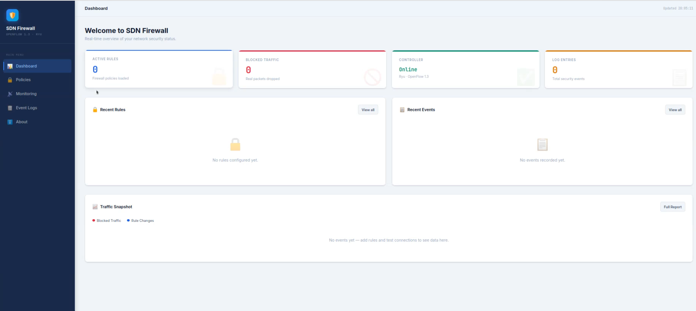
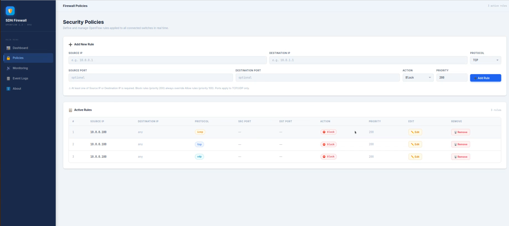
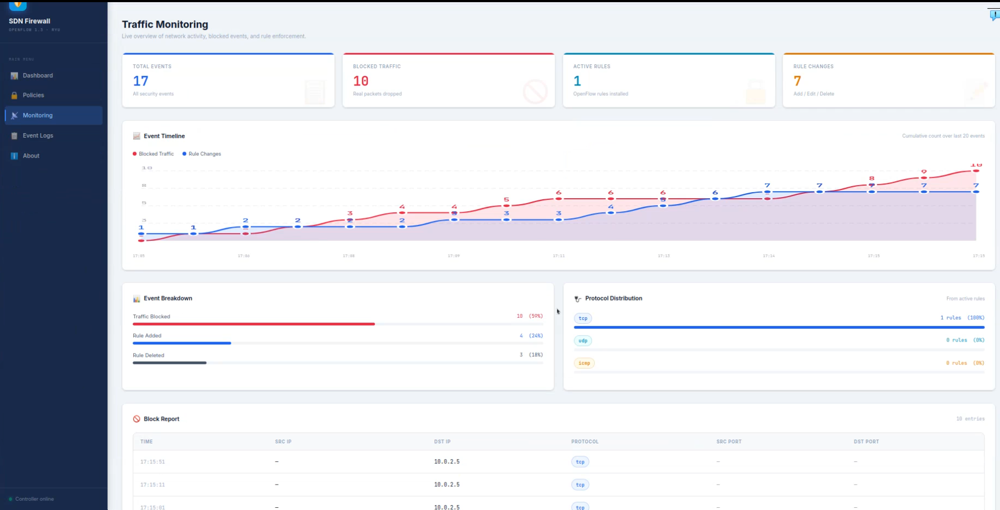
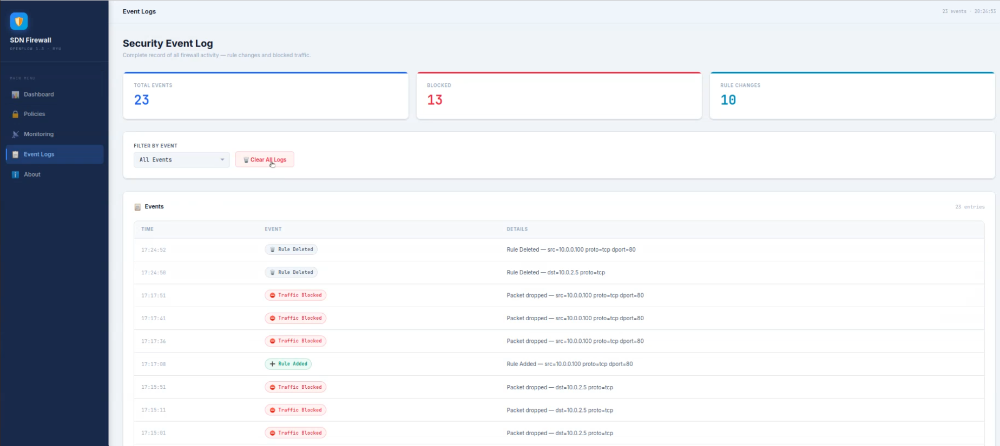
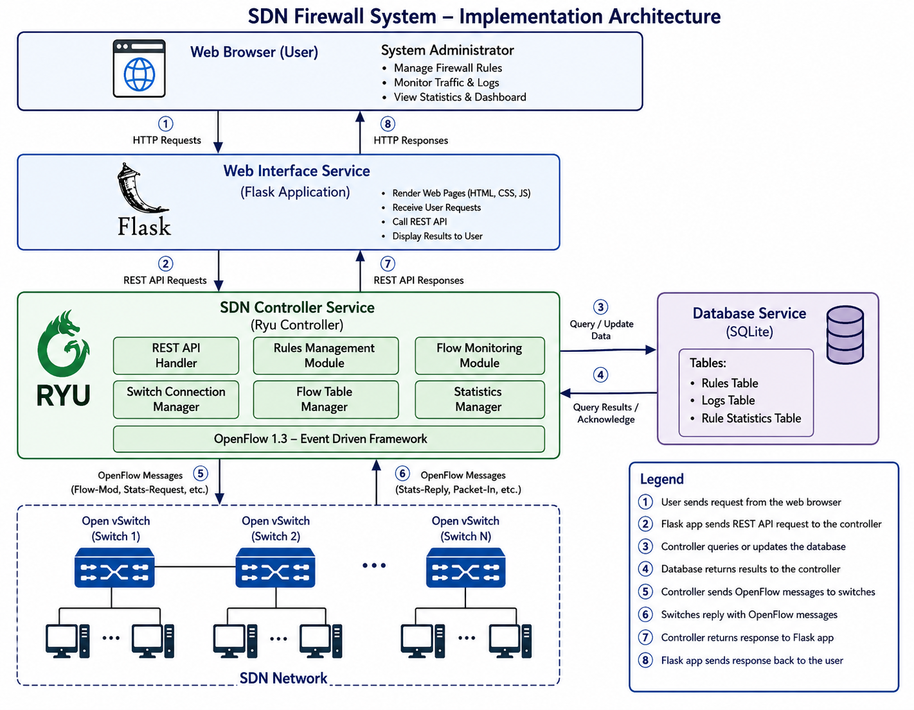
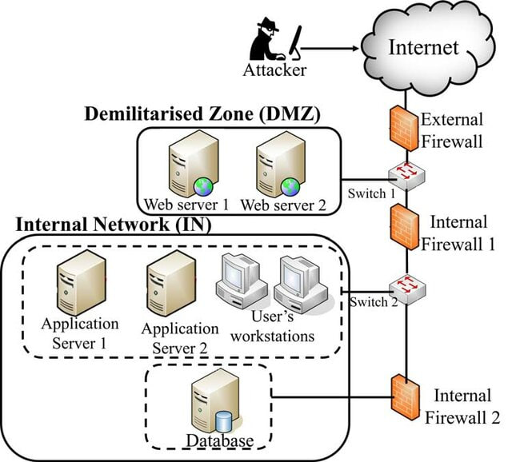
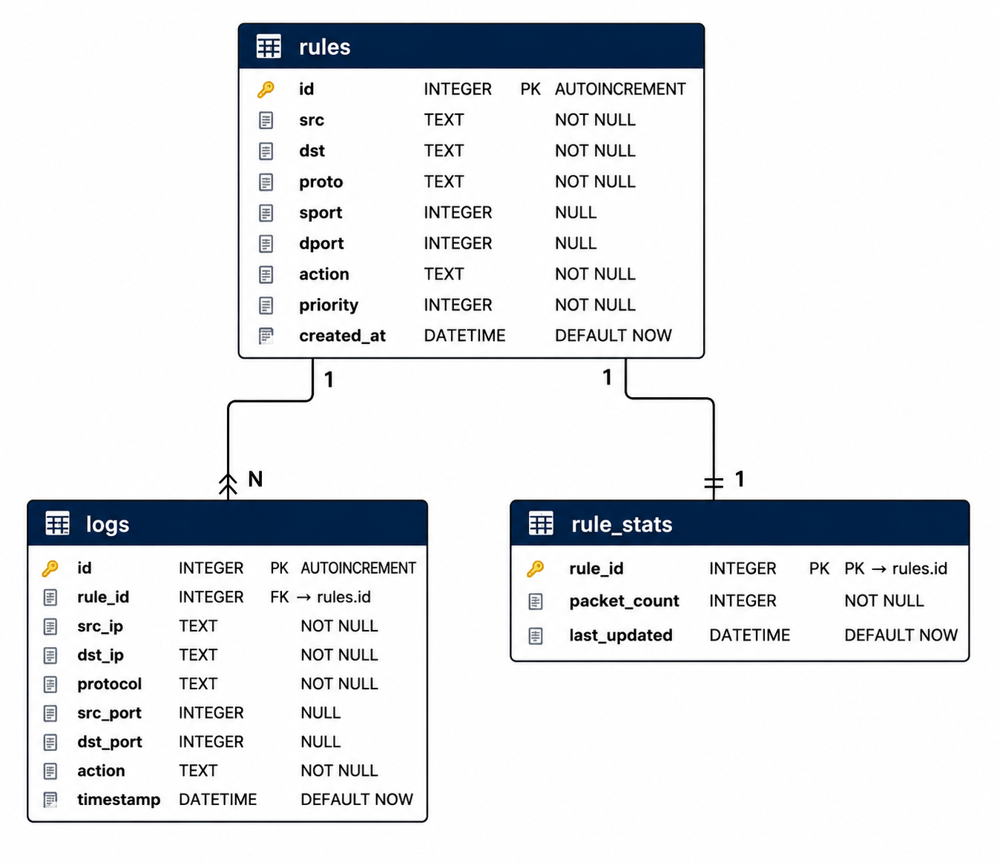

# SDN Firewall System

**A programmable network firewall powered by Software-Defined Networking (SDN).**

The SDN Firewall System is a network security project that combines centralized firewall policy management with a web-based interface and an SDN controller.

Built using Python, Flask, Ryu, OpenFlow 1.3, Open vSwitch, and SQLite, the system explores programmable traffic filtering, firewall rule management, and security event monitoring.

The project uses Containernet to create a simulated network environment for experimenting with and evaluating firewall policies.

<p align="center">
  
  
  
  
  
</p>

<p align="center">
  <a href="https://github.com/mhd-ghaith/firewall-SDN-system">View Repository</a>
  ·
  <a href="https://github.com/mhd-ghaith/firewall-SDN-system/issues">Report a Bug</a>
</p>

## Table of Contents

- [Overview](#overview)
- [Key Features](#key-features)
- [Screenshots](#screenshots)
- [System Architecture](#system-architecture)
- [Network Topology](#network-topology)
- [Technology Stack](#technology-stack)
- [Project Structure](#project-structure)
- [Requirements](#requirements)
- [Installation](#installation)
- [Quick Start](#quick-start)
- [Usage Example](#usage-example)
- [Database Schema](#database-schema)
- [Contributing](#contributing)
- [License](#license)

## Overview

Traditional network security configurations may require administrators to configure individual devices when traffic-filtering policies change. Software-Defined Networking (SDN) provides a programmable approach to network management by separating control logic from packet forwarding.

The SDN Firewall System explores this approach by integrating a web-based management interface with a Ryu SDN controller and OpenFlow-compatible switches.

The application provides a centralized interface for managing supported firewall policies and viewing available monitoring information. The controller processes firewall policies and communicates with the network infrastructure to enforce the configured behavior.

Containernet provides a controlled environment for creating network topologies and experimenting with traffic-filtering scenarios.

### Project Objectives

- Implement centralized firewall policy management.
- Configure traffic-filtering rules through a web interface.
- Enforce supported firewall policies using an SDN controller.
- Store firewall rules and security events in SQLite.
- Display available firewall and network monitoring information.
- Evaluate firewall behavior through controlled network experiments.

This project is intended for educational use and experimentation with programmable network security.

## Key Features

### Firewall Policy Management

- Manage firewall rules through a web interface.
- Configure supported source and destination addresses.
- Define protocol and port matching criteria where implemented.
- Configure allow and block actions.
- Use the rule-priority behavior implemented by the system.

### SDN-Based Enforcement

- Integrate with the Ryu SDN controller.
- Use OpenFlow 1.3 for communication with compatible switches.
- Apply firewall policies through the controller's enforcement logic.

### Monitoring and Logging

- View available traffic and firewall statistics.
- Inspect recorded security events.
- Review rule-related statistics supported by the implementation.

### Persistent Storage

- Store firewall rules in SQLite.
- Persist supported security event records.
- Maintain rule-related statistics where implemented.

### Network Simulation

- Use Containernet to create a configurable network environment.
- Experiment with simulated hosts and switches.
- Evaluate firewall behavior using controlled network tests.

### Machine Learning Algorithms

- Train the dataset [CSE-CIC-IDS2018](https://www.kaggle.com/datasets/solarmainframe/ids-intrusion-csv) on 5 different algorithms for binary classification (malicious vs benign traffic).
- Compare the results to conclude the best model.

## Screenshots

### Dashboard

The dashboard provides an overview of the system and its available monitoring information.



### Firewall Policy Management

Manage the firewall policies supported by the application.



### Traffic Monitoring

View the monitoring information provided by the system.



### Security Event Logs

Inspect recorded security events.



## System Architecture

The SDN Firewall System combines a web-based management interface, an SDN controller, OpenFlow-compatible switches, and a simulated network.

The web interface provides the management layer for configuring firewall policies. The Ryu controller handles the control logic and communicates with compatible switches through OpenFlow 1.3. The switches enforce the forwarding behavior configured by the controller.

SQLite provides persistent storage for the application data supported by the implementation.

The architecture separates management, control, packet forwarding, and persistence into distinct components.



## Network Topology

The project uses Containernet to create a configurable network environment for experimenting with SDN-based firewall policies.

The topology is defined in `sdn_topology.py` and describes the simulated network devices and connections used for testing.

This environment allows firewall policies to be evaluated under controlled conditions by generating traffic between selected hosts.



## Technology Stack

| Technology | Purpose |
|---|---|
| Python | Application and controller development |
| Flask | Web application and management interface |
| Ryu | Software-Defined Networking controller |
| OpenFlow 1.3 | Communication between the controller and compatible switches |
| Open vSwitch | Software-based switching and packet forwarding |
| SQLite | Persistent application data storage |
| Containernet | Network simulation using containers |
| Docker | Container runtime for the simulated environment |
| HTML, CSS, JavaScript | Web interface structure, styling, and client-side behavior |


## Project Structure

The repository is organized into the following main components:

```text
firewall-SDN-system/
├── controller/
│   └── firewall.py
├── docs/
│   └── images/
├── webUI/
│   ├── app.py
│   ├── static/
│   └── templates/
├── .gitignore
├── LICENSE
├── Model_Comparison.ipynb
├── README.md
└── sdn_topology.py
```

### Main Components

| Path | Description |
|---|---|
| `controller/` | SDN controller and firewall enforcement logic |
| `webUI/` | Flask application and web interface |
| `docs/images/` | Screenshots and architecture diagrams |
| `sdn_topology.py` | Network topology configuration |
| `Model_Comparison.ipynb` | Notebook for model-comparison experiments, if applicable |
| `LICENSE` | Project licensing terms |
| `README.md` | Project documentation |

## Requirements

The system depends on a compatible Python environment, an SDN controller, OpenFlow-compatible switching software, and the network simulation environment.

| Requirement | Purpose |
|---|---|
| Ubuntu or another verified Linux environment | Operating system |
| Python | Application and controller runtime |
| Flask | Web application |
| Ryu | SDN controller |
| Open vSwitch | OpenFlow-compatible switching |
| Docker | Container runtime, where required |
| Containernet | Network simulation |
| SQLite | Application data storage |

### Version Compatibility

The exact versions of the operating system, Python, Ryu, Open vSwitch, Docker, and Containernet should be documented based on a successfully tested installation.

See the installation instructions below for the setup procedure.

## Installation

### 1. Clone the Repository

Clone the repository and navigate to the project directory.

```bash
git clone https://github.com/mhd-ghaith/firewall-SDN-system.git
cd firewall-SDN-system
```

### 2. Install System Dependencies

Install the operating system packages and network components required by the project.

The exact installation commands depend on the supported Linux distribution and the required versions of Ryu, Open vSwitch, Docker, and Containernet.

### 3. Configure the SDN Controller

Install and configure the Ryu controller in a compatible Python environment.

Verify that the controller can start successfully before launching the simulated network.

### 4. Configure the Web Application

Create an isolated Python environment for the web application.

```bash
cd webUI
python3 -m venv .venv
source .venv/bin/activate
python3 -m pip install --upgrade pip
```

Install the dependencies required by the web application. If a `requirements.txt` file is provided, use it to install the documented dependencies.

### 5. Configure the Network Simulation

Install Containernet and its required dependencies according to the supported environment.

Ensure that the topology configuration is compatible with the installed controller and switching software.

### 6. Verify the Installation

Confirm that the controller starts successfully, the web application launches, and the network topology can be created without errors.

Proceed to the Quick Start section once all required components are configured.

## Quick Start

After completing the installation, start the system components in the following order.

### 1. Start the SDN Controller

Open a terminal and launch the Ryu controller using the verified controller command.

### 2. Start the Web Application

Open another terminal, activate the web application's Python environment, and launch the Flask application.

### 3. Start the Network Topology

Open a third terminal and launch the Containernet topology using the configured Python environment and required permissions.

### 4. Open the Dashboard

Open the configured web application address in your browser.

### 5. Verify Network Connectivity

Confirm that the controller is connected to the switches and that simulated hosts behave according to the configured firewall policies.

See the Usage Example section for a suggested firewall validation scenario.

## Usage Example

### Blocking HTTP Traffic

This example describes how to evaluate a firewall policy that blocks HTTP traffic to a designated test host.

#### Scenario

Configure a rule matching:

| Field | Example |
|---|---|
| Source host | A designated test client |
| Destination host | A simulated web server |
| Protocol | TCP |
| Destination port | 80 |
| Action | Block |

Use the actual IP addresses and hostnames defined in the network topology.

#### Procedure

1. Start the controller, web application, and network simulation.
2. Verify that the destination HTTP service is reachable before applying the rule, where the baseline policy permits it.
3. Create the blocking rule through the web interface.
4. Attempt the same connection again.
5. Inspect the controller and switch state to verify policy enforcement.
6. Review the security logs if the application records the event.

#### Expected Result

Traffic matching the blocking policy should be denied when the rule is correctly configured and enforced.

Repeat the experiment after removing or changing the rule to verify that the observed behavior corresponds to the configured policy.

## Database Schema

The system uses SQLite to store firewall-related information supported by the implementation.

| Table | Purpose |
|---|---|
| `rules` | Stores configured firewall rules |
| `logs` | Stores recorded security events |
| `rule_stats` | Stores rule-related statistics |

### Rules

The `rules` table stores the policy fields and metadata defined by the application.

### Logs

The `logs` table stores security event information recorded by the system.

### Rule Statistics

The `rule_stats` table stores the statistics maintained for firewall rules.




## Contributing

Bug reports, suggestions, and contributions are welcome.

Please read [CONTRIBUTING.md](CONTRIBUTING.md) before submitting changes.

## License

This project is distributed under the MIT License. See the [LICENSE](LICENSE) file for details.
